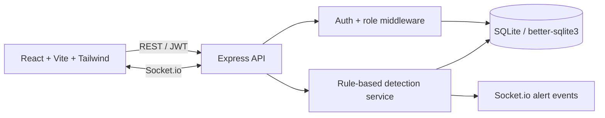

# Fungard Application

🚀 **Live Application:** [Click Here to Open Fungard](https://jeevaramesh463-web.github.io/fungard-/)

# FundGuard – Fund Transaction Alert System

A full-stack college Higher Order Assessment project (Problem 29) that records fund transactions and explains why activity is marked safe, suspicious, or blocked.

## Problem statement

Financial transactions can be unusual, high-value, or unauthorized. FundGuard monitors recorded activity, assigns a transparent rule-based risk score, and sends immediate in-app alerts to the account owner and administrators.

## Objectives and features

- JWT registration/login with User and Admin roles; passwords are hashed with bcrypt.
- Record credit, debit, and transfer transactions with amount, receiver, category, location, device, and time.
- Explainable server-side detection, risk statuses, and live Socket.io alerts.
- User dashboard, transaction history filters/search/sort/pagination, CSV export, and alert center.
- Admin overview, user/transaction management, transaction approve/block/false-positive actions, and editable thresholds.
- Console + database email/SMS simulation log; use **Simulate Transaction** to demonstrate live alerts.
- Responsive interface, theme toggle, form validation, and toast feedback.

## Architecture



## Technology

React, Vite, Tailwind CSS, React Router, Recharts, Express, SQLite (`better-sqlite3`), JWT, bcryptjs, Socket.io.

## Detection logic

Rules run on the server for each transaction. Each triggered rule contributes risk points (high value +30, amount >3× personal average +25, >5 transactions in 2 minutes +25, 00:00–04:59 +15, new location +10, new device +10, blocked/unknown account +50), capped at 100. A total of 60+ is **Blocked**, 30–59 **Suspicious**, otherwise **Safe**. The rule thresholds can be changed by an admin. An unauthorized match is blocked immediately. This educational demo simulates notifications; it does not connect to a bank or send real SMS/email.

## Setup and run

Requirements: Node.js 22+ and npm. From the project root:

```bash
npm run install:all
Copy-Item server\.env.example server\.env
npm run seed
npm run dev
```

Visit `http://localhost:5173`. API is at `http://localhost:4000/api`. The server creates its local SQLite database automatically. Copying `.env.example` is optional; defaults support local development.

Demo accounts (password for both: `FundGuard123!`):

- Admin: `admin@fundguard.local`
- User: `jamie@fundguard.local`
- User: `jayadharshan@fundguard.local`

Seed can be re-run safely; it resets demo records and inserts more than 100 sample transactions including flagged activity.

## Screenshots

Add screenshots of the landing page, user dashboard, transaction flow, and admin dashboard here after running the application.

## Project pages

Landing, Login/Register, User Dashboard, Add Transaction, Transaction History, Alerts, Admin Dashboard, Admin Rules, About/Project.

## Future scope

Integrate a real institution-approved transaction feed, configurable per-account limits, device fingerprinting, verified SMS/email providers, richer anomaly models, audit exports, and multi-factor authentication.

## Team

Jamie Anand Paul J, Jayadharshan B, Jeeva R, Jegan R  
SRM TRP Engineering College, Tiruchirappalli — Batch 29

See [docs/](docs/) for literature survey, proposed solution, and methodology.
